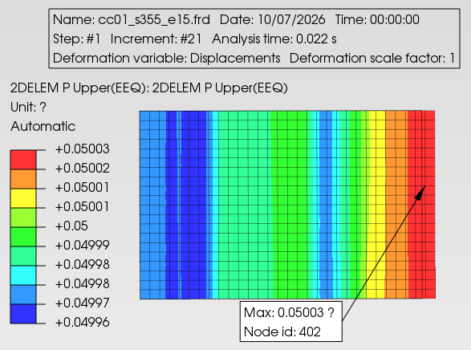
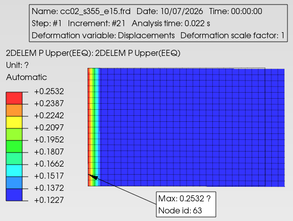

```{=typst}
#like_header("Calculation Objective / Scope")
```
* n/a


```{=typst}
#like_header("Calculation Assumptions")
```
* n/a


```{=typst}
#like_header("Software Used")
```
* Space Gass 14.00 for structural analysis
* IdeaStatica 25.1 for connections

```{=typst}
#like_header("Holds")
```
* n/a



```{=typst}
#block(above: 2em, below: 2em)[
    #outline(
      title: [Table of Contents],
      depth: 3,
      indent: auto
    );
    ]
```



```{julia}
#| label: Usings
#| echo: false
#| output: false
dir_proj = @__DIR__
# 1. Force PythonCall to your specific venv path
ENV["JULIA_PYTHONCALL_EXE"] = "/home/ubuntu/julia_repo/python_env/bin/python"
ENV["JULIA_CONDAPKG_BACKEND"] = "Null"
ENV["JULIA_PROJECT"] = dir_proj
import Pkg
Pkg.activate(dir_proj)

using Unitful, Unitful.DefaultSymbols, Revise
using MyUnits, WindLoadModule, MyHelper 
```

# Introduction

## Objective / Scope 

## Assumptions
* n/a


## Exclusions
* n/a

## Basis of Design

In general, design shall be in accordance with AS 4100 and other relevant standards.

## Design Standards and Codes

Unless specifically noted, the design complies with Australian Standards and selected international standards as listed in the Design Criteria. The following summarises the key standards used in producing this calculation:

* AS 1170.0 - 2002		Structural design actions - Part 0: General principles
* AS 1170.1 - 2002		Structural design actions - Part 1: Permanent, imposed and other actions
* AS 1170.2 - 2002		Structural design actions - Part 2: Wind actions
* AS 1170.4 - 2002		Structural design actions - Part 4: Earthquake actions
* AS 4100 - 1998		Steel structures

## Other Referenced Documents

Other information used in this design mainly for loads calculations, include:

* -

## Methodology 




# Loading and Load Combinations

## Structural dead load (GDstruct)

Roof dead load, reproduced from 22131-ST-CAL-0001



# Drawings
This calculation covers the structural components on the drawings and/or sketches listed in the following table:

<!-- add column as below to left justify -->

|Drawing Number|Drawing Title| Revision |
|---------|:----------|----------|
|0001|General Arrangement|A|
|0002|Details 1|0|
|0003|Details 2|C1|
|0004|Earthworks|x|
: {tbl-refdwgs tbl-colwidths="[20,70,10]"}



# Methodology, Loading and Load Combinations
Do some calculation here.

<!-- some double column figures 
::: {#fig-builtup_loads layout-ncol=2}

{#fig-load_central_builtup height="250"}

{#fig-load_edge_wb1000 height="250"}

Impact loading scenarios
:::

-->

<!-- attaching pdf files, A4, portrait 

```{=typst}
#let pdf-file = "appendices/baseplate_anchor_design.pdf"
#let n-pages = 16 // Set the total number of pages here

#for i in range(1, n-pages + 1) [
  // for ideastatica, use 90% scaling
  #image(pdf-file, page: i, width: 95%)
]
```
-->

# Sketches 

<!-- 
```{=typst}
#set page(paper: "a3", flipped: true, header: none)
```

```{=typst}
#let pdf-file = "raw_pdf/25068-ST-SKH-0005_A Flot cell structure cable ladders.pdf"
#let n-pages = 4 // Set the total number of pages here
#for i in range(1, n-pages + 1) [#image(pdf-file, page: i, width: 95%)]
```

```{=typst}
// for A3
#set page(header: none, margin: (top: 1.5cm))

#set page(paper: "a3", flipped: true, header: none)
#let pdf-file = "raw_pdf/595--6-005564S1RD-Markup_Mechanical_Masses_C1_tripper.pdf"
#let pdf-file2 = "raw_pdf/595--6-005737S1RH-mechanical weight mark up C2.pdf"

#let n-pages = 1 // Set the total number of pages here
#for i in range(1, n-pages + 1) [
  // for ideastatica, use 90% scaling
  #image(pdf-file, page: i, width: 98%)
  #image(pdf-file2, page: i, width: 98%)]
```

-->

# Appendix A - Plastic Strain Limit Calibration

## Gross yielding check

According to DNV-RP-C208 2016 ed., the plastic strain limit for steel is to be calibrated according to clause 5.1.3.2

{ width="300"}

```{julia} 
#| echo: true
ϵ_crg = 0.05  # from figure above 
γM = 1.2;  # additional safety factor for tensile fracture according to the procedure per DNV-RP-C208 5.1.3
ϵ_crg_uls = ϵ_crg / γM   # ultimate limit state, where L_yieldzone > 20t in the direction of principal strain, yield zone is when ϵp > 2%
```

## Local yielding check

**Strain Gradients**

For problems dominated by membrane strains (see DNV-RP-C208 example 8.1), but where the extent of the plastic zone as defined in clause 5.1.3.2 is less than 20 × t then the maximum local principal strain in any integration point in any element should be less than obtain from the analysis of CC01 modified as follows:

```{julia}
tp = 15mm  # calibration piece thickness
le = 2tp    # FE length (direction of principal strain)
ϵ_crl_uls = ϵ_crg_uls * (1+5tp/3le)  # equation 10, DNV-RP-C208
```

**Out-of-plane bending**


For problems dominated by *out-of-plane bending*, the local strain at the surface should be limited to what is obtained as the maximum surface strain found from analysing calibration case CC02 as shown in @fig-local_surf_limit. 

{#fig-local_surf_limit width="300"}

```{julia}
ϵ_crl_surface_uls = 0.25 / γM
```

The elements in the calibration analysis should have the same relative size relative to the thickness as for the elements in the area of interest. The **mid-point strain** should be limited to **ε_crl** as defined from CC01 and Equation (10) of DNV-RP-C208. 
